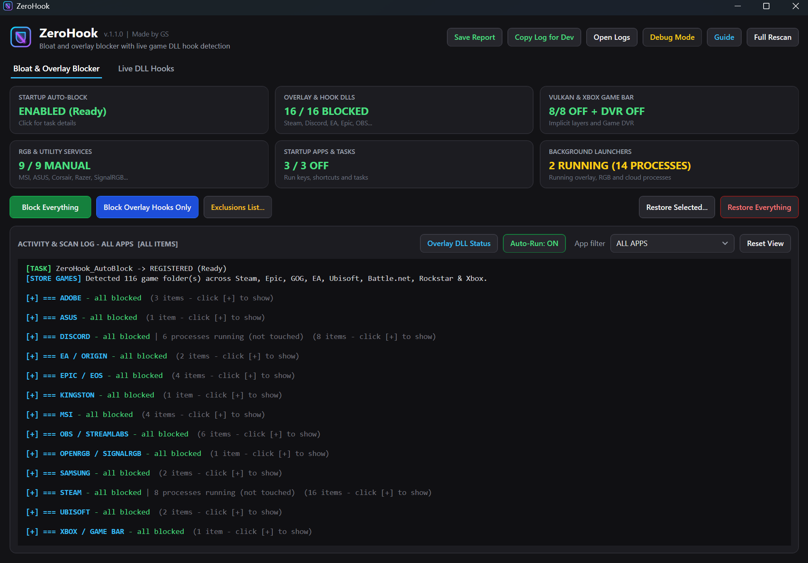

# ZeroHook

**Stop overlays and background bloat from hooking into your games.**

ZeroHook is a free Windows utility (PowerShell + WPF) that finds and blocks third-party overlay DLLs, Vulkan implicit layers, Xbox Game Bar capture, and vendor background bloat. It also shows you, live, which hook DLLs are actually loaded inside a running game.

No tray icon, no background service. Everything is reversible with one click.



---

## Quick Start

Open **PowerShell as Administrator** and run:

```powershell
$p = "$env:TEMP\ZeroHook.ps1"; irm "https://raw.githubusercontent.com/GS-ZeroHook/ZeroHook/main/ZeroHook.ps1" -OutFile $p; powershell -NoProfile -ExecutionPolicy Bypass -File $p
```

Prefer a portable app? Download **`ZeroHook.exe`** from the [Releases](../../releases) page.

Then:

1. *(Optional)* Open **Exclusions List...** and tick anything you want to keep, such as RGB or controller software.
2. Click **Block Overlay Hooks Only** (overlays, Vulkan layers, Game Bar) or **Block Everything** (also services, startup apps and tasks).
3. Turn **Auto-Run: ON** so your blocks are re-applied automatically after every logon.

---

## Why ZeroHook?

### "Disabled" overlays can still load into your game
Turning off an overlay in Steam, Discord or another launcher often only hides its interface. The overlay DLL (`GameOverlayRenderer64.dll`, `DiscordHook64.dll`, ...) can still be injected into the game, where it hooks DirectX or Vulkan and can add frame-time spikes or input latency.

GPU software does the same. With the **NVIDIA App** or **GeForce Experience** installed, NVIDIA's capture DLL (`nvspcap64.dll`, or `nvspcap.dll` in 32-bit games) is loaded into your games from the Windows system folder **even when the in-game overlay is turned off** in the app. AMD Software injects its capture DLL (`amddvr64.dll`) in a similar way. You can see this for yourself in ZeroHook's **Live DLL Hooks** tab.

ZeroHook blocks those files at the Windows permission level, so they **can't be loaded** at all.

> Blocking NVIDIA's or AMD's capture DLL also turns off their in-game overlay, Instant Replay and in-game recording. Your driver, game settings and performance features (DLSS, Reflex, G-Sync / FreeSync) are not affected.

### Set it once, forget it
- **Nothing left running:** ZeroHook doesn't sit in the tray using CPU or RAM while you play.
- **Survives updates:** launcher updates can replace overlay files, and Steam re-enables its Vulkan layers every time it starts. The optional **Auto-Run** task re-applies your blocks 60 seconds after each logon and skips everything on your Exclusions List.

---

## Features

### Bloat & Overlay Blocker
| What | How it's blocked | Restored to |
|---|---|---|
| **Overlay & hook DLLs**: Steam, Discord, Epic (EOS), EA, Ubisoft, GOG, Overwolf, OBS/Streamlabs, RTSS, NVIDIA and AMD capture, and more | Adds a *Deny Read & Execute* permission. No file is deleted or edited. | Permission removed |
| **Vulkan implicit layers** (machine-wide and per-user) | Layer marked as disabled in the registry | Enabled |
| **Xbox Game Bar / Game DVR** background capture | Capture settings turned off. **Windows Game Mode is never touched.** | Enabled |
| **Vendor services**: MSI, ASUS, Corsair, Razer, Logitech, SteelSeries, NZXT, Gigabyte, SignalRGB, OneDrive, Dropbox, Adobe... | Set to *Manual* and stopped | Automatic and started |
| **Startup entries & shortcuts** | Disabled the same way Task Manager does; shortcuts moved to a backup folder | Enabled / moved back |
| **Vendor scheduled tasks** (never Microsoft tasks) | Disabled | Enabled |

- **Exclusions List:** items you tick are never blocked. Includes quick presets for **RGB control** and **controllers / DualSense**.
- **Overlay DLL Status:** shows, per app, which overlay DLLs were found, blocked or excluded.
- **Restore Selected / Restore Everything:** undo single items or everything at once.
- **Game library detection:** finds Steam libraries on any drive, plus Epic, GOG, EA, Ubisoft, Battle.net, Rockstar and Xbox games.

### Live DLL Hooks
Reads the actual list of DLLs loaded inside a running game, so you can confirm a block really worked.

- **Pick a game, lock onto the foreground window, or tick *Auto-attach to games*** to start watching automatically when a game opens.
- **32-bit and 64-bit games** are both fully supported.
- **Disk state for every hook:** `NOT BLOCKED` (with a one-click **[Block]** link), `BLOCKED ON DISK` (it was loaded before the block, so restart the game) or `EXCLUDED`.
- **Real-Time Watch** catches hooks that load mid-game, even ones that load and unload quickly, and shows when each one loaded after game start.
- **Other Third-Party DLLs:** flags DLLs from outside the game and Windows folders that aren't signed by Microsoft or the game's publisher, such as antivirus, recorders and renamed mod proxies.
- **Mods recognised:** ReShade, OptiScaler, DXVK, DLSS / Streamline, FSR, XeSS, ASI Loader, Luma and more. These are shown for information only and never blocked.
- **Anti-cheat aware:** games protected by Easy Anti-Cheat, BattlEye, Vanguard and similar usually hide their DLL list. ZeroHook detects this and tells you, instead of showing an error.

### Built-in troubleshooting
- **Save Report:** saves a bug report as a `.txt` file you can attach in Discord or GitHub. User and computer names are masked automatically.
- **Debug Mode:** detailed logging for 24 hours, including the next Auto-Run, then switches itself off. No restart needed.
- **Guide:** an in-app explanation of every button and everything ZeroHook can block.

---

## Undo Everything

Every change is reversible:

1. Open ZeroHook as Administrator.
2. Click **Restore Everything** (red button, right side).
3. Blocked DLLs, Vulkan layers, Game Bar/DVR, services, startup items and tasks are restored, and the `ZeroHook_AutoBlock` task is removed.

> **Note:** Restore switches items **on**. Services go back to *Automatic*, and startup entries and tasks are enabled, even if some of them were already off before you used ZeroHook.

To undo just a few items, use **Restore Selected...** instead. If Auto-Run is on, also add those items to the Exclusions List, or they'll be blocked again at the next logon.

---

## Requirements

- **Windows 10 or 11**
- **Windows PowerShell 5.1** (built into Windows)
- **Administrator rights.** ZeroHook asks for them automatically. They are needed to change file permissions, services, scheduled tasks and registry keys.

---

## Command Line

```powershell
# Open the app (PowerShell as Administrator)
.\ZeroHook.ps1

# Re-apply saved blocks without a window (this is what the Auto-Run task runs)
.\ZeroHook.ps1 -AutoBlock

# Open with debug logging for this session only
.\ZeroHook.ps1 -DebugLog
```

---

## Files & Logs

| Path | Contents |
|---|---|
| `%LOCALAPPDATA%\ZeroHook\exclusions.json` | Your Exclusions List |
| `%LOCALAPPDATA%\ZeroHook\Logs\zerohook-current.log` | App log |
| `%LOCALAPPDATA%\ZeroHook\Logs\zerohook-autoblock.log` | Auto-Run log |
| `%LOCALAPPDATA%\ZeroHook\Logs\zerohook-report-*.txt` | Saved bug reports |
| `%ProgramData%\ZeroHook\` | Copy of the script used by the Auto-Run task |
| `%ProgramData%\ZeroHook_StartupBackup\` | Startup shortcuts moved out by ZeroHook |

---

## Reporting a Bug

1. *(Optional)* Click **Debug Mode**, then reproduce the problem.
2. Click **Save Report**. Explorer opens on the report file.
3. Attach the file to a [GitHub issue](../../issues) or send it on Discord.

User and computer names are masked in reports. Please check the file yourself before sharing it publicly.

---

## Important Notes

- **Anti-cheat & launchers:** changing permissions on launcher or overlay DLLs can, in rare cases, trigger launcher integrity checks, anti-cheat warnings or crashes in some online games. If a game misbehaves, restore that app's DLLs with **Restore Selected...** and add them to the Exclusions List.
- **Service side effects:** stopping vendor services can pause RGB sync, fan/pump curves, peripheral macros or cloud sync (OneDrive, Dropbox) until they're restored. Use the **RGB control** or **Controller / gamepad** presets in the Exclusions List to keep them running.
- **Fully auditable:** everything runs from the single `ZeroHook.ps1` script in this repository. Read it before you run it.
